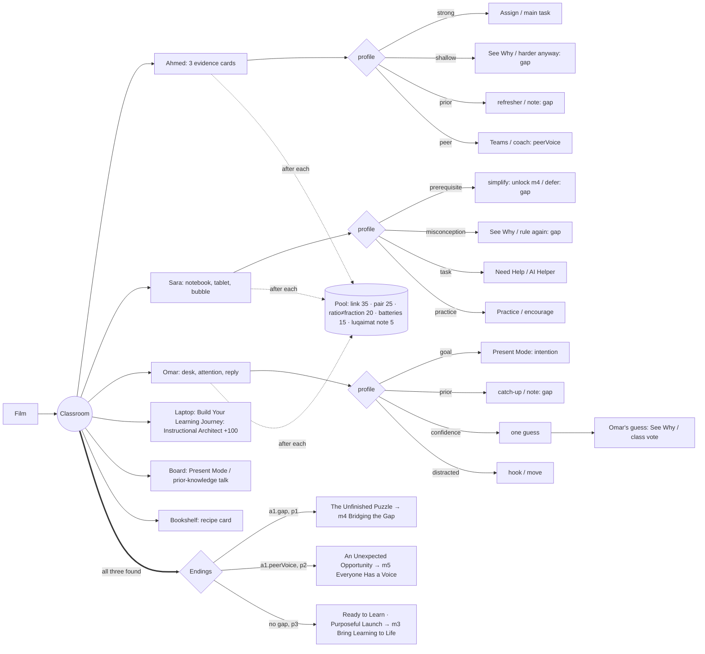

# Teacher content: "Every Classroom Has a Story"

Owner: Hessa (game & learning design). Source of truth for `src/teacher/data/**`.
Authority: `docs/product/ALEF_PROPOSAL.md` wins over every earlier brief.
Validate with `npx vite-node tools/teacher/check-content.ts` (static checks
plus 8,000 simulated plays per mission).

## Principles applied

- The player helps **Ms. Mariam**, a UAE public-school teacher. No mentor or
  DLIS character appears in mission content.
- **Investigate, then decide.** Each student is an investigation: one coherent
  evidence profile is drawn (weighted) when the encounter opens, every clue
  agrees with it, and the choices offered depend on it. Outcomes follow the
  teacher's choice, never a random draw, so a supportive choice is never
  "ineffective" by luck.
- **No countdown.** Missions are `timed: false`; "five minutes" is the story.
  Choice `minutes` are 0–1 narrative values only.
- **Randomness varies events, it never judges teaching**: profiles and pool
  events change what happens; outcome tones depend only on choices.
- **XP** (illustrative): 30 per resolved investigation (on the outcome), 50
  per first discovery of an NCLE tool (engine, from `discover`), 100 for the
  planning puzzle (`puzzle.xp`). Once per meaningful action. XP is never
  described as competence or achievement.
- **No fixed-ability labels** in player text ("strong", "weak", "low group"
  never appear; profile ids are internal).
- Every choice is a real option a teacher would consider; deferring is
  allowed and honest ("Noted, not yet solved"), never shamed.

## Engine contract (what the content assumes)

1. Untimed missions: every `schedule` event is a hotspot, open from the start.
   The player chooses the order and may skip objects.
2. An event with `investigate` draws one profile by `weight` when opened and
   sets its `setFlag`. Clue texts come from `profile.clues[clue.id]`;
   `clue.text` is the neutral prompt shown before the tap. Choices show when
   their `ifFlag` is unset or set.
3. **Pool events** have `category` + `weight` (+ optional `eligible`) and are
   neither scheduled nor opened by an outcome. After each student encounter
   resolves, the engine draws one among the eligible unseen ones (weights
   normalised); none eligible → back to exploration. A pool event pulses on
   its `on` hotspot; if that hotspot's own event is still open, it comes first.
   Weights follow the proposal: learning 35 · collaboration 25 ·
   misconception 20 · management 15 · bonus 5.
4. A choice whose outcome id equals `puzzle.id` opens the puzzle; the outcome
   shows after it. `puzzle.badge` and `puzzle.xp` are awarded on completion.
5. Milestone: every student hotspot event is resolved. The player may finish
   open events, then the mission closes with the eligible ending of lowest
   `priority`; other eligible endings are offered as choices.
6. `Ending.opens` and any flag `unlock:<missionId>` unlock missions.
7. `badges[]` is the mission's badge catalogue and end-of-run rule list (first
   match); `Ending.badge` and `puzzle.badge` award from the same catalogue.
8. Choice `resource` is not used in missions; tools are discovered through
   `Outcome.discover`.

## Arabic conventions

Natural MSA as a Gulf teacher writes it; Arabic-Indic digits and `٪`; «» for
quotes; Ms. Mariam addressed in the feminine (اختاري، انظري); "Try it Monday"
lines in the generic masculine imperative used by Arabic teacher guides;
short childlike student lines (أستاذة، خلّصت). «ألف» in guillemets. NCLE tool
names are translated descriptively (وضع العرض، اعرف السبب) and must be
replaced by Alef's official Arabic names once verified.

## NCLE tools (`resources.ts`, all `placeholder: true`)

| Tool | Stage (proposed) | First mission | What the game says it does (proposal only) |
|---|---|---|---|
| Present Mode | Launch | M01 | share the learning intention; open a prior-knowledge discussion |
| Gamification | Launch | M05 | game elements used on purpose |
| Need Help | Facilitate | M01 | task guidance for a student |
| See Why | Facilitate | M01 | question the reasoning behind an answer |
| AI Helper | Facilitate | M01 | another source of task guidance |
| Practice | Facilitate | M01 | reinforcement |
| Teams | Facilitate | M01 | collaboration |
| Assign | Extend | M01 | give work matched to where the student is (e.g. extension) |
| Class Progress | Extend | M06 | a view of class progress |
| Exit Ticket | Extend | M06 | a short end-of-lesson check |
| Show My Learning | Extend | M07 | students show what they learned |
| Exam Prep Assessment | Extend | M07 | assessment for exam preparation |
| Pathways | Extend | M07 | different routes through learning |

## To verify (every product claim in the content)

Alef product specialists sign off each line; until then `placeholder: true`.

**General**
- V1. Official English and Arabic names of all 13 NCLE tools.
- V2. The stage each tool belongs to (Launch / Facilitate & Synthesize / Extend & Assess).
- V3. "Build Your Learning Journey" is labelled a simplified illustration; confirm the three stage names and that no real screen is implied.

**Mission 01**
- V4. Assign can be used to give one student more challenging (extension) work.
- V5. Present Mode can show a lesson's learning intention to the class from the board.
- V6. Present Mode can open a prior-knowledge discussion.
- V7. See Why supports questioning a student's reasoning / surfacing a misconception.
- V8. Need Help gives a student guidance on the task in front of them.
- V9. AI Helper can explain what a question is asking, in the student's words.
- V10. Practice gives short reinforcement before moving on.
- V11. Teams supports pairing two students with roles (explain / check).
- V12. Grade 7 Math ratios / unit rates is a suitable NCLE lesson context (subject not given in the proposal; content designer's choice).

---

## Mission 01 · The First Five Minutes (MVP)

`a1` · Grade 7 · Math (yesterday: equivalent ratios; today: unit rates) ·
Ahmed, Sara, Omar · laptop, board, bookshelf · 5–8 min, untimed.

**Teacher's learning goal:** in the first minutes, find each student's real
starting point from evidence (answer, reasoning, application; notebook,
tablet, words; desk, attention, reply) before choosing a response, and match
the response to the need.

**Opening film** (7 beats over 5 pictures): arrival → students arrive →
Ahmed / Sara / Omar lines (verbatim) on one picture → "Five minutes before we
begin. Where should I start?" → pull back into the classroom. Opening screen:
"MISSION 01 | The First Five Minutes · Your classroom. Your decisions. Your
adventure." (the UI adds "Start Playing").

### Evidence profiles

| Student | Profile (weight) | Flag | Choices → outcome |
|---|---|---|---|
| Ahmed · Confidence Detective (answer / explanation / application) | strong (35) | `a1.ahmed:strong` | Assign a challenge → *Ready for more* (Assign, `unlock:m2`) · start main task → *Finishes first again* |
| | correct, weak reasoning (25) | `a1.ahmed:shallow` | "Why does that rule work?" → *The rule cracks* (See Why) · harder task anyway → *Rule will break later* (`a1.gap`) |
| | can't apply prior knowledge (20) | `a1.ahmed:prior` | 2-min decimals refresher → *One step back* · note for later → *Noted* (`a1.gap`) |
| | strong + peer question (20) | `a1.ahmed:peer` | pair them (Teams) → *A pair, on purpose* (`a1.peerVoice`) · "Let Omar try first" → *Helping, not telling* (`a1.peerVoice`) |
| Sara · Find the Missing Piece (notebook / tablet / bubble) | missing prerequisite (30) | `a1.sara:prerequisite` | simplify together → *The missing piece* (`unlock:m4`) · start new topic → *Gap goes with her* (`a1.gap`) |
| | repeated misconception (25) | `a1.sara:misconception` | "Show me how you got 4:5" → *Adding, not multiplying* (See Why) · rule again → *The rule, again* (`a1.gap`) |
| | needs task guidance (25) | `a1.sara:task` | Need Help → *Guidance on the task* · AI Helper → *She asks what it means* |
| | needs reinforcement (20) | `a1.sara:practice` | Practice → *A little more* · encourage → *Still unsure* |
| Omar · What's Behind the Silence? (desk / attention / reply) | unclear goal (30) | `a1.omar:goal` | Present Mode → *Now he knows* (`a1.intention`) · tell him quietly → *His table doesn't* |
| | missing prior knowledge (25) | `a1.omar:prior` | yesterday's example → *Yesterday in two minutes* · note for later (`a1.gap`) |
| | low confidence (25) | `a1.omar:confidence` | "One guess, no names" → opens **Omar's guess** investigation · tell a partner (Teams, `a1.peerVoice`) |
| | distraction (20) | `a1.omar:distracted` | sports-day hook → *metres per second* · move closer → *still elsewhere* |

Omar's guess (2:3 = 3:4, additive) is the proposal's "a student response may
reveal a misconception and open a new investigation": See Why, or a class
discussion (`a1.peerVoice`).

### Map

Pool eligibility: the speed-in-science link skips Ahmed's "shallow" profile;
the ratio-is-a-fraction misconception skips Sara's "misconception" profile so
the same morning never stacks two near-identical misconceptions.

**Simulated play (random choices):** XP 90–220, median 190; top ending
Unfinished 46 %, Opportunity 43 %, Ready 12 % (random play defers often; a
deliberate player reaches Ready by resolving every need).

### Picture briefs

Scene `public/teacher/scenes/m01.jpg` (portrait 2:3): a Grade 7 classroom in
a UAE public school, morning light from a window on the left, students in
school uniform (boys' white kandura-style uniform, girls' uniform with white
shayla, consistent with the existing art). **Omar** by the window (18/44),
sitting back, pen down. **Sara** front-left (34/58) with an open notebook and
tablet, flicking back pages. **Ahmed** centre-right (64/50), tablet already
on today's lesson, half turning to talk. **Board** top-centre (50/16), clean.
**Laptop** open on the teacher's desk lower-right (82/64). **Bookshelf** on
the left wall upper area (10/30) with an atlas and globe. Keep the bottom
30 % calm (sheet area). No text on the board.

Film `public/teacher/film/m01-1…5.jpg` (portrait 2:3, same art style):
1. Ms. Mariam (Emirati, abaya and shayla, lanyard, tote bag) at the classroom
   door, morning corridor behind her.
2. Students coming in, bags going down, the room filling.
3. Close group shot of Ahmed (eager, hand half up), Sara (worried, notebook
   held up) and Omar (quiet, looking at the window); used for all three lines.
4. Ms. Mariam at her desk, looking out over the room, a beat of thought.
5. Wide pull-back: the whole classroom as in the scene picture.

---

## Shop and Term Pass (customisation)

`shop.ts`: 10 outfits, 14 accessories, 5 power-ups; prices in thank-you
notes, earned only from the Term Pass (`termPass.ts`, 12 steps, one per
finished mission or replay) and the end-of-term bundle. One term earns 54
notes plus 5 gifted items; the 24 cosmetics cost 56 after gifts, so a full
term buys most cosmetics and about three power-ups, never everything.
Professional rewards (NCLE tool cards, story chapters, planner pages,
spotlights) are never priced.

Open issue: the shop includes Toki outfits and accessories (per the earlier
shop brief), but the proposal says the teacher game needs no Toki. Product
to decide: keep Toki as a cosmetic-only companion, or retarget those items
to Ms. Mariam / the classroom.

## Internal sample

`adventures/sample-g5-fractions.ts` is the approved Grade 5 fractions demo
ported to the schema (timed). Not registered in `ADVENTURES`; validated as a
sample. Flags renamed `g5.*`; resources mapped to the nearest NCLE tool.
