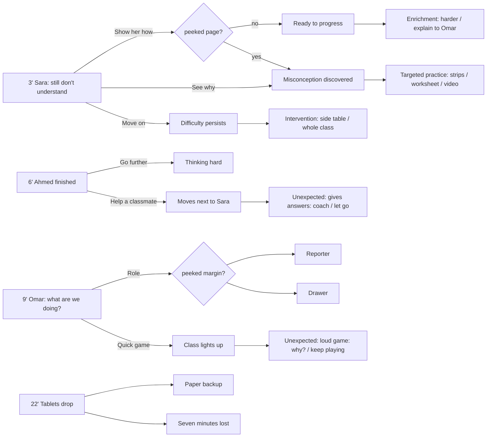
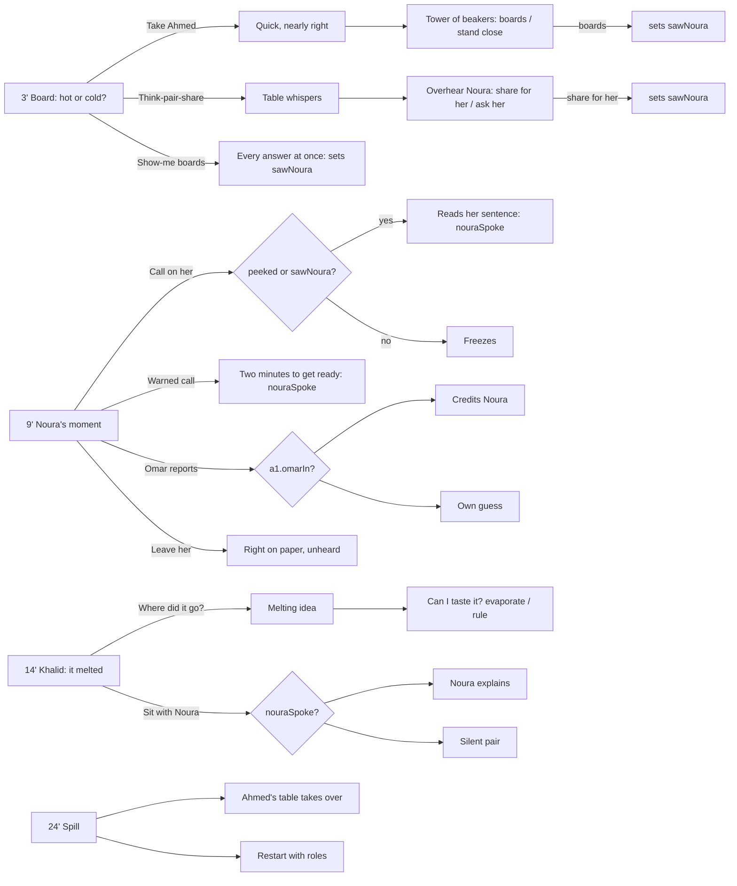
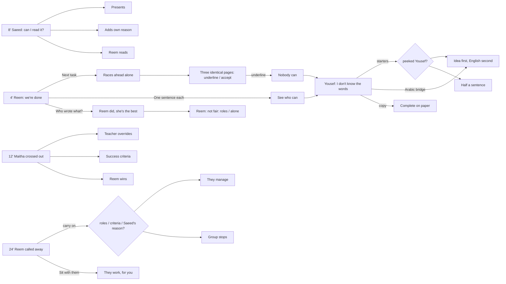
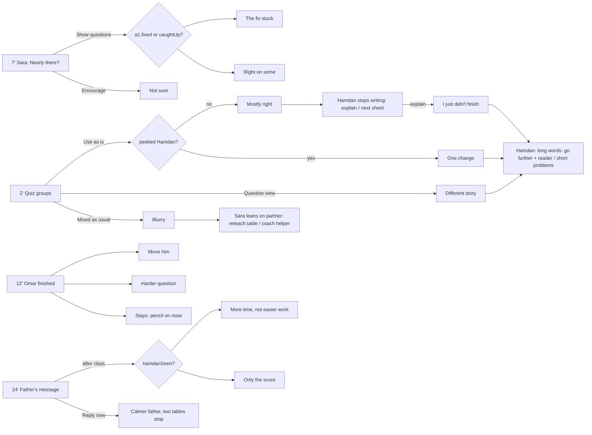

# Teacher content: Ms. Mariam's School

Owner: Hessa (game & learning design). Source of truth for the content in
`src/teacher/data/**`. Validate with `npx vite-node tools/teacher/check-content.ts`.

## How the content is built

- **The player is a real UAE public-school teacher playing Ms. Mariam**, an
  Emirati homeroom teacher who teaches Grade 5 Math and Science, covers
  Grade 6 English, and teaches Grade 4 Arabic reading. Same person as in
  Coach mode.
- **No points, no currencies.** What changes is the story, where each student
  lands (understanding/engagement 0–3) and the teacher's toolkit.
- **Every choice is a real trade-off.** It costs lesson minutes; there is no
  option a real teacher would not consider. Good intentions can backfire
  (calling on a quiet student cold; sending the helper to help; reassuring a
  parent mid-lesson). Outcome titles describe what happened, never judge the
  teacher. `poor` outcomes say what the student did, not what the teacher
  did wrong.
- **Nonlinear.** Outcomes open different follow-up events; peeks set flags
  that change later outcomes (peeking at Sara's page turns *Show her how*
  into *Misconception discovered*); flags carry across adventures (Omar's
  role in A1 changes A2; Sara's fix in A1 changes her quiz in A4).
- **Resources** are plain teaching moves, all `placeholder: true` until Alef
  maps each to a real feature (see the last section).

### What the content assumes the engine does

The validator plays every adventure 6,000 times against this model:

1. The lesson clock starts at 0. `schedule` events open at their minute.
2. A choice costs `minutes`; the outcome's `next` opens `after` minutes later.
3. An event opened at or after `lessonMinutes` is not played; it can appear
   in the debrief as "not reached before the bell".
4. Effects clamp to 0–3. A student counts as "good" when understanding +
   engagement ≥ 5, "partly there" at ≥ 3 (as in the demo). `all-good` = all
   students good at the bell.
5. A peek is offered only before that student's first event is answered.
6. Flags live in `TeacherSave.flags` and persist across adventures. All flag
   names are namespaced `aN.name`.
7. Conditional outcomes: first entry whose `ifFlag` is set wins; the last
   entry has no `ifFlag` and is the default.

### Arabic conventions

Natural MSA as a Gulf teacher writes it: Arabic-Indic digits, «» quotes,
Ms. Mariam addressed in the feminine (أنتِ، اختاري); "Try it Monday" lines
addressed to the real teacher in the generic masculine imperative
(جرّب، أعطِ), as Arabic teacher guides do. Students speak short, childlike
lines (خلّصت، أستاذة). Glossary follows `docs/content/ARABIC_REVIEW.md`
(engagement = التفاعل, participation = المشاركة, exit ticket = بطاقة الخروج,
success criteria = معايير النجاح, cold call = النداء بالاسم).

### Cross-adventure flags

| Flag | Set in | Read in | Effect |
|---|---|---|---|
| `a1.omarIn` | A1: Omar's role / drawing / game "why?" | A2 *Let Omar report* | Omar reports Noura's idea, crediting her (vs his own guess) |
| `a1.fixed`, `a1.caughtUp` | A1: fraction strips / reteach | A4 *Show Sara her questions* | Her quiz proves the fix stuck (vs partial) |

## Alef resources (16)

| Stage | Resource | First appears |
|---|---|---|
| Launch | Launch game · Printed backup task · Think, pair, share · Success criteria · Results-based groups | A1 · A1 · A2 · A3 · A4 |
| Facilitate & Synthesise | Worked example · Explain-your-thinking prompt · Team roles · Small-group reteach · Warned call · Show-me boards · Own-part check · Sentence starters | A1 · A1 · A1 · A1 · A2 · A2 · A3 · A3 |
| Extend & Assess | Extension task · Targeted practice set · Question-by-question results | A1 · A1 · A4 |

---

## A1 · Different Needs, Same Classroom (Grade 5 Math)

**Teacher's learning goal:** "I don't understand" hides different needs. Diagnose
before you fix (explain-your-thinking, a look at the page), give early
finishers depth rather than a job, and coach helpers to ask instead of tell.

**Port notes:** faithful to the approved demo (same events, costs, outcomes,
positions, scene). Improvements: Omar has a peek (a crossed-out fraction bar);
with it, *Give him a role* becomes *Omar draws it for his table* (u+2). Flags
now record the result for later adventures. "Need help" relabelled *Show her
how* so the action, not the student, is named.

**Resources:** worked example, explain-your-thinking (3 places), extension
task (2), team roles (3), launch game, targeted practice, small-group
reteach, printed backup.

**Scene:** existing `story/busy-classroom/w1-open-4.jpg` (positions from the demo).

**Badges:** Every Learner In (all-good) · Misconception Hunter (`a1.misconception`) · First Lesson Logged.

**Claims Alef must verify:** that Alef lessons include (or pair with) a launch
game, a worked example, an extension ("go further") task and a targeted
practice set chosen by mistake type; that a printed version of a lesson task
can be produced; whether Alef has any explain-your-thinking prompt or it is a
teacher move only.

---

## A2 · The Quiet Table (Grade 5 Science)

**Teacher's learning goal:** volunteers are not the class. Structures that
give every student thinking time (think-pair-share, show-me boards) and a
*warned* call get quiet students' ideas into the room; a cold call on a
silent child backfires unless you already know what she wrote.

**Story:** sugar in hot vs cold water. Noura (capable, silent) has the best
reason in the room in her notebook. Khalid believes the sugar "melted and is
gone" (in Arabic the trap is ذاب = melt *and* dissolve, so the misconception
is written as اختفى, vanished). Omar sits at the quiet table; Ahmed's hand is
always up.

**Resources:** think-pair-share, show-me boards (2), warned call, team roles
(2), explain-your-thinking, extension task.

**Scene picture brief (`public/teacher/scenes/a2.jpg`, portrait 2:3):**
Grade 5 science lesson in a UAE public school classroom, girls in school
dress with white shaylas and boys in kandura-style uniform (as in the
existing art), seen from the front. A window on the left. **Quiet table**
front-left, lower half: Khalid (boy, 16/58) at the window end turning a
beaker, Noura (girl, 30/64) writing in a small notebook, head down, Omar
(boy, 42/56) looking towards other tables. **Experiment tray** with two
beakers, sugar cubes and a timer on the quiet table's front edge (30/78).
**Ahmed** (boy, 72/42) at a busier table back-right, hand half raised. The
**board** top-centre (50/16) with the question in Arabic and English. Other
students soft in the background, 3–4 visible hands up on the right side only.

**Badges:** The Whole Table In (all-good) · Room for Quiet Voices (`a2.nouraSpoke`) · Listened Closely.

**Claims Alef must verify:** that Alef science lessons have a prediction /
launch question stage; whether Alef has a digital "show-me" response (all
students answer at once, teacher sees all) or this stays a mini-whiteboard
move; whether any Alef tool supports choosing (or randomising) who answers.

---

## A3 · The Group That Copies (Grade 6 English)

**Teacher's learning goal:** a finished group page can hide who learned.
Make individual contributions visible (own-part check), give the strong
student a different job (checker), use success criteria to settle disputes,
and scaffold language (sentence starters, home-language bridge) for the
student who copies because he can't yet write it.

**Story:** Ms. Mariam covers Ms. Fatima's Grade 6 English: a group
persuasive paragraph, "Should our school have a longer break?" Reem does
everything; Saeed is charming and presents; Maitha's ideas get crossed out;
Yousef copies because his English is the weakest (his peek: a real reason,
written in Arabic). At minute 24 Reem is called to the office for ten
minutes: the group copes only if the work was shared (`a3.rolesShared`,
`a3.criteria` or `a3.saeedOwn`).

**Resources:** extension task, own-part check (2), team roles (2), success
criteria, sentence starters.

**Scene picture brief (`public/teacher/scenes/a3.jpg`, portrait 2:3):**
Grade 6 English classroom, mixed-gender UAE public school (uniforms as in the
existing art). One **group table** fills the lower two-thirds, seen at a
slight high angle. Reem (girl, 56/60) has the single **group sheet** pulled
towards her and is writing; Saeed (boy, 74/54) at the right end mid-joke,
leaning back; Yousef (boy, 30/56) at the left end copying carefully from
Reem's side; Maitha (girl, 42/70) nearest the viewer, pen lifted, about to
speak. The sheet itself near the front edge (50/80). The classroom **door**
top-right (88/30), slightly open onto a corridor. A whiteboard behind with
"Should our school have a longer break?" in English.

**Badges:** Everyone Holds the Pen (all-good) · A Team Without Its Star (`a3.coped`) · Looked Behind the Page.

**Claims Alef must verify:** whether Alef English has group-writing tasks
where individual contributions are tracked; whether success criteria /
checklists are shown with Alef writing tasks; whether sentence starters or
language scaffolds exist in Alef English for lower-proficiency students.

---

## A4 · Data Day (Grade 5 Math)

**Teacher's learning goal:** use last week's results to start the lesson,
look at the questions behind a score before acting on it, and let groups
move when students show more. Talk to parents with evidence, after class.

**Story:** three groups from last week's fractions quiz. Hamdan is in
Reteach with 3/10, but every answer he gave was right; he ran out of time on
long word problems. Sara has moved up and doesn't believe it (her quiz
depends on A1). Omar finishes the reteach sheet early. At minute 24 Hamdan's
father messages: "Why is my son in the weak group?"

**Resources:** results-based groups (3), question-by-question results (2),
explain-your-thinking (3), targeted practice, small-group reteach.

**Scene picture brief (`public/teacher/scenes/a4.jpg`, portrait 2:3):**
the same Grade 5 classroom as A1/A2, rearranged into three group tables with
small coloured table signs (no "high/low" words). Hamdan (boy, 26/62) at the
left table, finger under a line of a worksheet, reading slowly; Omar (boy,
44/70) front-centre at the same table, pen moving fast; Sara (girl, 64/56)
at the middle table, half turned to look at the board. Ms. Mariam's **tablet
with quiz results** on her desk top-right (82/30); her **phone** face-up at
the desk edge lower-right (88/64). Board top-left with three group colours
and names.

**Badges:** Everyone in the Right Place (all-good) · Behind the Score (`a4.hamdanSeen`) · Read the Data.

**Claims Alef must verify (highest priority):** that Alef reports
question-level results per student, including blank vs wrong; whether Alef
suggests groups from results and under what names (the game avoids "weak"
everywhere except the father's message); whether parents can see group
names in any Alef or school app (the father's message assumes they can: if
not, rewrite it as "Hamdan told me he's in the weak group").
