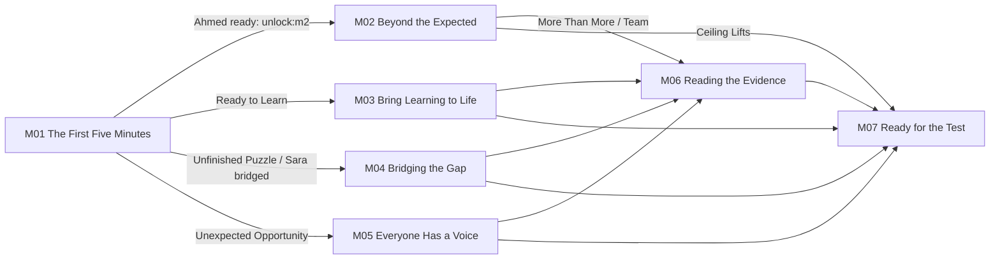
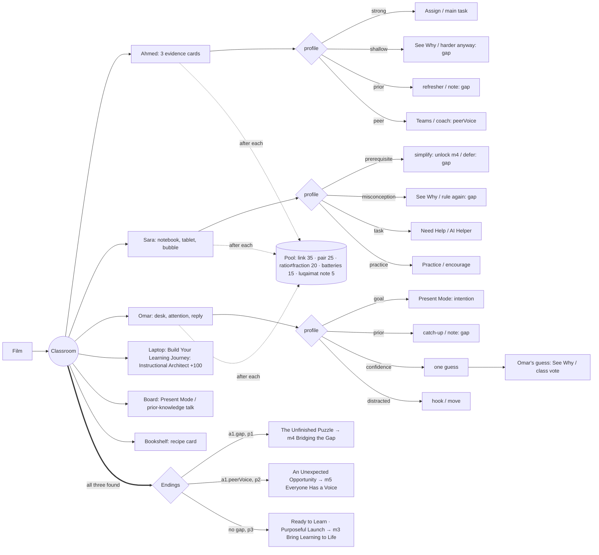
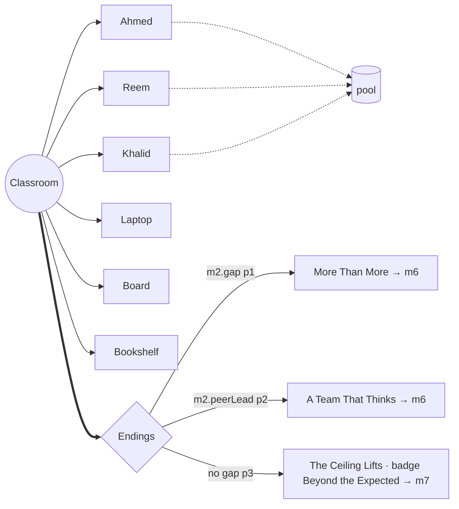

# Teacher content: "Every Classroom Has a Story"

Owner: Hessa (game & learning design). Source of truth for `src/teacher/data/**`.
Authority: `docs/product/ALEF_PROPOSAL.md` wins over every earlier brief.
Validate with `npx vite-node tools/teacher/check-content.ts` (static checks
plus 8,000 simulated plays per mission).

## Principles applied

- The player helps **Ms. Mariam**, a UAE public-school teacher. No mentor or
  DLIS character appears in mission content.
- **Investigate, then decide.** Each student is an investigation: one coherent
  evidence profile is drawn (weighted) when the encounter opens, every clue
  agrees with it, and the choices offered depend on it. Outcomes follow the
  teacher's choice, never a random draw, so a supportive choice is never
  "ineffective" by luck.
- **No countdown.** Missions are `timed: false`; "five minutes" is the story.
  Choice `minutes` are 0–1 narrative values only.
- **Randomness varies events, it never judges teaching**: profiles and pool
  events change what happens; outcome tones depend only on choices.
- **XP** (illustrative): 30 per resolved investigation (on the outcome), 50
  per first discovery of an NCLE tool (engine, from `discover`), 100 for the
  planning puzzle (`puzzle.xp`). Once per meaningful action. XP is never
  described as competence or achievement.
- **No fixed-ability labels** in player text ("strong", "weak", "low group"
  never appear; profile ids are internal).
- Every choice is a real option a teacher would consider; deferring is
  allowed and honest ("Noted, not yet solved"), never shamed.

## Engine contract (what the content assumes)

1. Untimed missions: every `schedule` event is a hotspot, open from the start.
   The player chooses the order and may skip objects.
2. An event with `investigate` draws one profile by `weight` when opened and
   sets its `setFlag`. Clue texts come from `profile.clues[clue.id]`;
   `clue.text` is the neutral prompt shown before the tap. Choices show when
   their `ifFlag` is unset or set.
3. **Pool events** have `category` + `weight` (+ optional `eligible`) and are
   neither scheduled nor opened by an outcome. After each student encounter
   resolves, the engine draws one among the eligible unseen ones (weights
   normalised); none eligible → back to exploration. A pool event pulses on
   its `on` hotspot; if that hotspot's own event is still open, it comes first.
   Weights follow the proposal: learning 35 · collaboration 25 ·
   misconception 20 · management 15 · bonus 5.
4. A choice whose outcome id equals `puzzle.id` opens the puzzle; the outcome
   shows after it. `puzzle.badge` and `puzzle.xp` are awarded on completion.
5. Milestone: every student hotspot event is resolved. The player may finish
   open events, then the mission closes with the eligible ending of lowest
   `priority`; other eligible endings are offered as choices.
6. `Ending.opens` and any flag `unlock:<missionId>` unlock missions.
7. `badges[]` is the mission's badge catalogue and end-of-run rule list (first
   match); `Ending.badge` and `puzzle.badge` award from the same catalogue.
8. Choice `resource` is not used in missions; tools are discovered through
   `Outcome.discover`.

## The term at a glance

Seven missions, one Grade 7 class (Ms. Mariam teaches its Math and Science).
Endings and `unlock:` flags open the next missions; a player can follow
any path and every mission is reachable (checked by the validator).

| Mission | Subject | Students | NCLE tools discovered | Outcomes |
|---|---|---|---|---|
| M01 | Math, unit rates | Ahmed, Sara, Omar | Assign, Present Mode, See Why, Need Help, AI Helper, Practice, Teams | 40 |
| M02 | Math, discounts | Ahmed, Reem, Khalid | Assign, Teams, See Why, Practice, Present Mode | 32 |
| M03 | Science, falling objects | Sara, Hamdan, Noura | Present Mode, See Why, AI Helper, Need Help, Teams, Assign | 34 |
| M04 | Math, proportions | Sara, Omar, Maitha | Practice, Need Help, AI Helper, Teams, See Why, Assign, Present Mode | 33 |
| M05 | Science, food chains | Omar, Noura, Saeed | Teams, Gamification, Present Mode, See Why | 32 |
| M06 | Math, end of lesson | Ahmed, Sara, Omar | Exit Ticket, Class Progress, See Why, Practice, Assign, Teams | 35 |
| M07 | Math, end of unit | Ahmed, Sara, Omar | Exam Prep Assessment, Pathways, Show My Learning, Practice, Teams, See Why | 38 |

Each mission: opening film, 3 students as weighted-profile investigations
(3–4 profiles, 2 profile-gated choices each), 3 hotspot objects (one may be
an investigation of the whole class), 4 weighted pool events, 3 endings by
priority, 3 badges, a flag-dependent teaser, a takeaway, 2 example
community posts. XP per run: 90–220 (M01 with the puzzle), 90–120 elsewhere.

**Cross-mission continuity:** M04 reads `unlock:m4` (Sara bridged in M01);
M05 reads `a1.peerVoice` (Omar's voice in M01); M07 reads `m2.stretch`,
`m4.closed`, `m5.allVoices`. Each changes an outcome, never which choices
are offered.

## Arabic conventions

Natural MSA as a Gulf teacher writes it; Arabic-Indic digits and `٪`; «» for
quotes; Ms. Mariam addressed in the feminine (اختاري، انظري); "Try it Monday"
lines in the generic masculine imperative used by Arabic teacher guides;
short childlike student lines (أستاذة، خلّصت). «ألف» in guillemets. NCLE tool
names are translated descriptively (وضع العرض، اعرف السبب) and must be
replaced by Alef's official Arabic names once verified.

## NCLE tools (`resources.ts`, all `placeholder: true`)

| Tool | Stage (proposed) | First mission | What the game says it does (proposal only) |
|---|---|---|---|
| Present Mode | Launch | M01 | share the learning intention; open a prior-knowledge discussion |
| Gamification | Launch | M05 | game elements used on purpose |
| Need Help | Facilitate | M01 | task guidance for a student |
| See Why | Facilitate | M01 | question the reasoning behind an answer |
| AI Helper | Facilitate | M01 | another source of task guidance |
| Practice | Facilitate | M01 | reinforcement |
| Teams | Facilitate | M01 | collaboration |
| Assign | Extend | M01 | give work matched to where the student is (e.g. extension) |
| Class Progress | Extend | M06 | a view of class progress |
| Exit Ticket | Extend | M06 | a short end-of-lesson check |
| Show My Learning | Extend | M07 | students show what they learned |
| Exam Prep Assessment | Extend | M07 | assessment for exam preparation |
| Pathways | Extend | M07 | different routes through learning |

## To verify (every product claim in the content)

Alef product specialists sign off each line; until then `placeholder: true`.
V1–V12 are below; mission-specific claims V13–V41 close each mission
section (M02 V13–17, M03 V18–22, M04 V23–27, M05 V28–31, M06 V32–36,
M07 V37–41). Also to verify across all missions: V42 Grade 7 Math and
Science are the right showcase subjects; V43 the Arabic tool names.

**General**
- V1. Official English and Arabic names of all 13 NCLE tools.
- V2. The stage each tool belongs to (Launch / Facilitate & Synthesize / Extend & Assess).
- V3. "Build Your Learning Journey" is labelled a simplified illustration; confirm the three stage names and that no real screen is implied.

**Mission 01**
- V4. Assign can be used to give one student more challenging (extension) work.
- V5. Present Mode can show a lesson's learning intention to the class from the board.
- V6. Present Mode can open a prior-knowledge discussion.
- V7. See Why supports questioning a student's reasoning / surfacing a misconception.
- V8. Need Help gives a student guidance on the task in front of them.
- V9. AI Helper can explain what a question is asking, in the student's words.
- V10. Practice gives short reinforcement before moving on.
- V11. Teams supports pairing two students with roles (explain / check).
- V12. Grade 7 Math ratios / unit rates is a suitable NCLE lesson context (subject not given in the proposal; content designer's choice).

---

## Mission 01 · The First Five Minutes (MVP)

`a1` · Grade 7 · Math (yesterday: equivalent ratios; today: unit rates) ·
Ahmed, Sara, Omar · laptop, board, bookshelf · 5–8 min, untimed.

**Teacher's learning goal:** in the first minutes, find each student's real
starting point from evidence (answer, reasoning, application; notebook,
tablet, words; desk, attention, reply) before choosing a response, and match
the response to the need.

**Opening film** (7 beats over 5 pictures): arrival → students arrive →
Ahmed / Sara / Omar lines (verbatim) on one picture → "Five minutes before we
begin. Where should I start?" → pull back into the classroom. Opening screen:
"MISSION 01 | The First Five Minutes · Your classroom. Your decisions. Your
adventure." (the UI adds "Start Playing").

### Evidence profiles

| Student | Profile (weight) | Flag | Choices → outcome |
|---|---|---|---|
| Ahmed · Confidence Detective (answer / explanation / application) | strong (35) | `a1.ahmed:strong` | Assign a challenge → *Ready for more* (Assign, `unlock:m2`) · start main task → *Finishes first again* |
| | correct, weak reasoning (25) | `a1.ahmed:shallow` | "Why does that rule work?" → *The rule cracks* (See Why) · harder task anyway → *Rule will break later* (`a1.gap`) |
| | can't apply prior knowledge (20) | `a1.ahmed:prior` | 2-min decimals refresher → *One step back* · note for later → *Noted* (`a1.gap`) |
| | strong + peer question (20) | `a1.ahmed:peer` | pair them (Teams) → *A pair, on purpose* (`a1.peerVoice`) · "Let Omar try first" → *Helping, not telling* (`a1.peerVoice`) |
| Sara · Find the Missing Piece (notebook / tablet / bubble) | missing prerequisite (30) | `a1.sara:prerequisite` | simplify together → *The missing piece* (`unlock:m4`) · start new topic → *Gap goes with her* (`a1.gap`) |
| | repeated misconception (25) | `a1.sara:misconception` | "Show me how you got 4:5" → *Adding, not multiplying* (See Why) · rule again → *The rule, again* (`a1.gap`) |
| | needs task guidance (25) | `a1.sara:task` | Need Help → *Guidance on the task* · AI Helper → *She asks what it means* |
| | needs reinforcement (20) | `a1.sara:practice` | Practice → *A little more* · encourage → *Still unsure* |
| Omar · What's Behind the Silence? (desk / attention / reply) | unclear goal (30) | `a1.omar:goal` | Present Mode → *Now he knows* (`a1.intention`) · tell him quietly → *His table doesn't* |
| | missing prior knowledge (25) | `a1.omar:prior` | yesterday's example → *Yesterday in two minutes* · note for later (`a1.gap`) |
| | low confidence (25) | `a1.omar:confidence` | "One guess, no names" → opens **Omar's guess** investigation · tell a partner (Teams, `a1.peerVoice`) |
| | distraction (20) | `a1.omar:distracted` | sports-day hook → *metres per second* · move closer → *still elsewhere* |

Omar's guess (2:3 = 3:4, additive) is the proposal's "a student response may
reveal a misconception and open a new investigation": See Why, or a class
discussion (`a1.peerVoice`).

### Map

Pool eligibility: the speed-in-science link skips Ahmed's "shallow" profile;
the ratio-is-a-fraction misconception skips Sara's "misconception" profile so
the same morning never stacks two near-identical misconceptions.

**Simulated play (random choices):** XP 90–220, median 190; top ending
Unfinished 46 %, Opportunity 43 %, Ready 12 % (random play defers often; a
deliberate player reaches Ready by resolving every need).

### Picture briefs

Scene `public/teacher/scenes/m01.jpg` (portrait 2:3): a Grade 7 classroom in
a UAE public school, morning light from a window on the left, students in
school uniform (boys' white kandura-style uniform, girls' uniform with white
shayla, consistent with the existing art). **Omar** by the window (18/44),
sitting back, pen down. **Sara** front-left (34/58) with an open notebook and
tablet, flicking back pages. **Ahmed** centre-right (64/50), tablet already
on today's lesson, half turning to talk. **Board** top-centre (50/16), clean.
**Laptop** open on the teacher's desk lower-right (82/64). **Bookshelf** on
the left wall upper area (10/30) with an atlas and globe. Keep the bottom
30 % calm (sheet area). No text on the board.

Film `public/teacher/film/m01-1…5.jpg` (portrait 2:3, same art style):
1. Ms. Mariam (Emirati, abaya and shayla, lanyard, tote bag) at the classroom
   door, morning corridor behind her.
2. Students coming in, bags going down, the room filling.
3. Close group shot of Ahmed (eager, hand half up), Sara (worried, notebook
   held up) and Omar (quiet, looking at the window); used for all three lines.
4. Ms. Mariam at her desk, looking out over the room, a beat of thought.
5. Wide pull-back: the whole classroom as in the scene picture.

---

## Mission 02 · Beyond the Expected

`m2` · Grade 7 · Math (percentages, discounts) · Ahmed, Reem, Khalid ·
opened by `unlock:m2` (Ahmed's ready profile in M01).

**Teacher's learning goal:** extension means depth, not volume. Check that
"ready" is real (fast is not the same as deep), give open problems through
Assign, and let ready learners lead by asking, not by doing others' work
(Teams with roles).

| Student | Profiles (weight) → choices |
|---|---|
| Ahmed (yesterday's work / explanation / with peers) | deep 40 → open problem (Assign, `m2.stretch`) · group leader (does it all, `m2.takeover`) — fast 30 → "estimate first" (See Why) · harder set (`m2.gap`) — leader 30 → questioner role (Teams, `m2.peerLead`) · teach at front (`m2.takeover`) |
| Reem (check / working / words) | ready 40 → same open problem · her own challenge (both Assign) — compare 35 → "what would you find interesting?" · Ahmed's task — gap 25 → Practice first · extension now (`m2.gap`) |
| Khalid (face / notebook / words) | unsure 40 → own way in (Assign) · pair with Ahmed (good if `m2.peerLead`, else carried) — ready 30 → open problem too · core task — social 30 → roles for three (Teams) · alone |

Objects: laptop (open problem via Assign / ten harder questions), board
(three methods side by side via Present Mode / model answer), bookshelf
(receipt collectible). Pool: discount-on-discount (learning 35, not for the
"fast" profile) · Reem vs Khalid disagreement (collaboration 25) ·
"20% off then 20% on" (misconception 20) · sheets run out (management 15).

**Scene brief (`teacher/scenes/m02.jpg`, 2:3):** the M01 Grade 7 classroom,
same light. Ahmed centre-right (62/50) bent over a sheet; Reem front-left
(36/56) leaning to see Ahmed's work; Khalid by the window (20/46), alone,
sheet half hidden. Laptop, board, bookshelf as in M01. A receipt sticks out
of a book on the shelf. **Film** `m02-1…3`: (1) Ahmed waiting at the door
holding a finished sheet; (2) the three students at the front, Ahmed eager,
Reem determined, Khalid hanging back (all three lines); (3) Ms. Mariam
looking at the three, deciding.

**To verify:** V13 Assign can give different students different extension
tasks (open problem vs set) · V14 Assign can send a task to students'
tablets when printouts run out · V15 Present Mode can show several student
methods side by side · V16 Teams supports giving roles (questioner, checker,
recorder) inside a group · V17 Practice gives a short targeted set
(decimal–percent conversions).

---

## Mission 03 · Bring Learning to Life

`m3` · Grade 7 · Science (falling objects, air resistance) · Sara, Hamdan,
Noura · opened by M01 "Ready to Learn".

**Teacher's learning goal:** open from students' prior knowledge, out loud,
so a shared misconception (heavier falls faster) is visible before it is
taught against; use Present Mode after predictions, not instead of them.

The **board is an investigation of the class**: hands / reasons / the quiet
ones, with profiles *shared misconception* 45 · *split class* 35 · *most
already know* 20. Choices: discussion vs show-the-answer (shared); sides
convince each other (Teams) vs show (split); deeper question vs re-prove
(ready).

| Student | Profiles (weight) → choices |
|---|---|
| Sara (notebook / example / words) | everyday experience 40 → "light, or air?" (See Why) · tell her (`m3.gap`) — word confusion mass/weight 30 → AI Helper · Need Help word card — nearly there 30 → she designs the test (`m3.peerVoice`) · carry on |
| Hamdan (hands / reason / drawing) | loud and sure 40 → predict then test · correct publicly (`m3.gap`) — quietly doubts 30 → pair with a disagreer (Teams) · call on him (safe answer) — unsure 30 → prediction card · follow the class (`m3.gap`) |
| Noura (notebook / face / words) | Moon-video link 40 → put it on the board (Present Mode) · park — missed last lesson 30 → Need Help catch-up · note (`m3.gap`) — did it last year 30 → Assign parachute question · helper |

Objects: laptop (clip after predictions vs now, Present Mode), bookshelf
(Galileo poster). Pool: falcon question (learning 35) · tables argue
(collaboration 25) · "air pushes heavy things down" (misconception 20, not
when the class is ready) · water spill (management 15).

Endings: **Not Yet Shaken** (`m3.gap`, p1) → m6 · **The Class Taught
Itself** (`m3.peerVoice`, p2) → m7 · **Learning Comes Alive** (no gap, p3,
badge Brought to Life) → m6, m7.

**Scene brief (`teacher/scenes/m03.jpg`):** the Grade 7 room set for
science: two identical clear bottles (one full of water) on the teacher's
desk. Hamdan centre-right (66/48) holding a bottle in each hand; Sara
front-left (34/58) writing; Noura by the window (20/44), quiet, watching.
Board top-centre with two bottle sketches; laptop lower-right; rolled poster
behind books on the shelf (10/30). **Film** `m03-1…3`: (1) close-up of the
two bottles on the desk; (2) the three students reacting (Hamdan sure, Sara
nodding, Noura doubtful); (3) Ms. Mariam holding the bottles up, about to ask.

**To verify:** V18 Present Mode can show a short clip / image to the class ·
V19 Present Mode can show a student's example (photo + sentence) · V20 AI
Helper can explain a science word (mass) to a student · V21 Need Help can
offer task guidance such as a vocabulary card or a one-line recap · V22
Assign can give one student an extension question mid-lesson.

---

## Mission 04 · Bridging the Gap

`m4` · Grade 7 · Math (proportions) · Sara, Omar, Maitha · opened by M01
"The Unfinished Puzzle" or `unlock:m4` (Sara's bridge in M01).

**Teacher's learning goal:** a gap is a specific missing step. Check
readiness before the new topic, identify the exact step (simplifying? times
tables? the task's wording? confidence?), then match the support: Need Help
for task guidance, AI Helper for explaining wording or an idea, Practice for
reinforcement.

**Continuity:** if Sara was bridged in M01 (`unlock:m4`), her Practice
choice gives *Yesterday's bridge holds* (u+2); otherwise *The first step,
five times* (u+1).

| Student | Profiles (weight) → choices |
|---|---|
| Sara (warm-up / yesterday's page / words) | still stuck on simplifying 35 → Practice · hint (Need Help, `m4.gap`) — times-table facts 35 → Practice facts · grid for today (`m4.gap`) — gap closed 30 → Assign today's task · check again |
| Omar (desk / attempt / words) | task wording 40 → Need Help · AI Helper — missed ratios 30 → AI Helper catch-up · pair with Sara (good if `m4.closed`, else both stuck) — confidence 30 → Practice 3+1 · "your first answer was right" |
| Maitha (tablet / notebook / words) | English wording 40 → AI Helper · simplify the question (`m4.gap`) — repeated adding 30 → See Why · show quick method — ahead 30 → Assign stretch · check with Sara (Teams) |

Objects: laptop (three-question readiness check vs skip, `m4.gap`), board
(bridge yesterday's question into today's intention, Present Mode),
bookshelf (times-table chart). Pool: Sara sees the bridge (learning 35,
not when stuck) · Maitha explains to Omar (collaboration 25) · "just
cross-multiply" (misconception 20) · login trouble (management 15).

Endings: **The Gap Is Smaller** (`m4.gap`, p1) → m6 · **A Bridge, Shared**
(`m4.peerVoice`, p2) → m7 · **The Bridge Is Built** (no gap, p3, badge
Bridge Builder) → m6, m7.

**Scene brief (`teacher/scenes/m04.jpg`):** Grade 7 room. Sara front-left
(34/58) with two notebooks open side by side; Omar by the window (18/44)
staring at a tablet; Maitha centre-right (64/52) underlining a long word
problem. "2 : 3 = 6 : ?" on the board. Folded chart between dictionaries on
the shelf. **Film** `m04-1…3`: (1) the board with yesterday's ratio and
today's title; (2) the three students, each with their own worry; (3) Ms.
Mariam looking from one to the next.

**To verify:** V23 Need Help can give a hint for the current question · V24
AI Helper can explain an English word in a maths question · V25 AI Helper
can explain a previous lesson's idea to a student who missed it · V26
Practice can target a specific prerequisite (simplifying, times-table facts)
· V27 Assign can give one student today's task or a stretch problem.

---

## Mission 05 · Everyone Has a Voice

`m5` · Grade 7 · Science (food chains, review) · Omar, Noura, Saeed ·
opened by M01 "An Unexpected Opportunity".

**Teacher's learning goal:** participation is designed. Thinking time, a
partner or team first, and roles bring in quiet voices; a dominant voice is
given a listening job; Gamification is used on purpose (everyone answers,
reasons score) rather than as a speed race the usual students win.

**Continuity:** if Omar's voice moved someone in M01 (`a1.peerVoice`), his
team choice gives *"Like last time"* (u+1, e+2).

| Student | Profiles (weight) → choices |
|---|---|
| Omar (margin / face / words) | confidence 40 → tell your team first (Teams) · call on him (`m5.fewVoices`) — science words 30 → picture word bank (Present Mode) · own words first — loves games, guesses 30 → game round needing "why" (Gamification) · quick quiz |
| Noura (notes / table / words) | very quiet 40 → reporter with rehearsal (Teams) · call on her — prefers writing 30 → write then read one line · push gently — leads small groups 30 → group leader (Teams) · present to class |
| Saeed (hand / answers / others) | dominates 40 → summariser role (Teams) · let him answer (`m5.fewVoices`) — answers for others 30 → coach him to ask · keep helping — confident, half wrong 30 → See Why · praise (`m5.fewVoices`) |

Objects: laptop (team rounds with thinking time vs speed buzzer, both
Gamification), board (talk rule via Present Mode vs hands up), bookshelf
(name sticks). Pool: Noura's whispered link (learning 35) · Saeed's team
disagrees (collaboration 25) · food-chain arrows backwards (misconception
20) · game too loud (management 15).

Endings: **The Same Voices** (`m5.fewVoices`, p1) → m6 · **Everyone Has a
Voice** (`m5.allVoices`, p2, badge) → m7 · **A Voice Found** (no
`fewVoices`, p3) → m6, m7.

**Scene brief (`teacher/scenes/m05.jpg`):** Grade 7 room arranged in team
tables for a review game. Omar by the window (18/44) with a neat food chain
in his margin; Noura front-left (36/60) with full notes, hand down; Saeed
centre-right (66/48) hand up high. Board shows "Sun → grass → gazelle → ?"
with simple pictures. A small box on the shelf (10/30). **Film**
`m05-1…3`: (1) the board and team tables before the game; (2) Saeed eager,
Omar resigned, Noura holding up her notebook; (3) Ms. Mariam at the laptop
choosing the game format.

**To verify:** V28 Gamification can run team rounds where every team answers
(not only first-to-buzz) · V29 Gamification can include a reasoning ("why")
step · V30 Present Mode can show a picture word bank or a talk rule · V31
Teams supports roles such as reporter, summariser, leader.

---

## Mission 06 · Reading the Evidence

`m6` · Grade 7 · Math (ratios and proportions, end of lesson) · Ahmed,
Sara, Omar · opened by endings of M02–M05.

**Teacher's learning goal:** the last five minutes mirror the first five.
Get individual evidence (Exit Ticket), read it before trusting a feeling or
a self-rating, and plan tomorrow from it (Class Progress): one shared
mistake, two starting points, or move on with a few in mind.

The **laptop is an investigation of the class** (Class Progress): who
finished / most-missed question / time, with profiles *one shared mistake*
40 · *class split* 35 · *mostly secure* 25.

| Student (ticket) | Profiles (weight) → choices |
|---|---|
| Ahmed (answers / reasoning / self-rating) | secure 40 → Assign tomorrow's challenge · "see you tomorrow" — sure and wrong 30 → "explain question 2" (See Why) · trust the rating (`m6.gap`) — careless slip 30 → estimate then check (Practice) · let it go |
| Sara (answers / working / self-rating) | improving 40 → Practice for tomorrow's start · "done" — old adding idea back 30 → See Why · mark wrong (`m6.gap`) — ran out of time 30 → "how far did you get?" · score blank as wrong (`m6.gap`) |
| Omar (answers / working / face) | right by luck 35 → See Why · tick it (`m6.gap`) — secure 35 → specific feedback · just collect — not handed in 30 → one question aloud · chase tomorrow (`m6.gap`) |

Board: two-question exit ticket (Exit Ticket, `m6.ticket`) vs "any
questions?" (`m6.gap`). Bookshelf: last year's sorted tickets. Pool: Sara
asks to see her own progress (learning 35, Class Progress, own data only) ·
peer marking (collaboration 25) · "5 out of 5" on wrong answers
(misconception 20) · bell in two minutes (management 15).

Endings (all open m7): **Loose Ends** (`m6.gap`, p1) · **Tomorrow,
Planned** (`m6.plan`, p2, badge Evidence Reader) · **The Evidence, Read**
(no gap, p3).

**Scene brief (`teacher/scenes/m06.jpg`):** the Grade 7 room at the end of a
lesson, afternoon light. Ahmed centre-right (62/50) packing up, ticket on
the desk; Sara front-left (34/58) re-reading her ticket; Omar by the window
(18/44) looking at the wall clock. Laptop open on a class overview
(stylised, no real UI). Thin folder on the shelf. **Film** `m06-1…3`: (1)
a busy, happy lesson in its last minutes; (2) the three students with their
tickets; (3) the wall clock and Ms. Mariam with a pile of tickets.

**To verify:** V32 Exit Ticket can be a short (two-question) individual
check at the end of a lesson · V33 Exit Ticket can include a self-rating ·
V34 Class Progress shows who completed a task and which questions were
most missed · V35 Class Progress can show one student their own progress
over time (no comparison with others) · V36 Assign can give a student
tomorrow's task before they leave.

---

## Mission 07 · Ready for the Test

`m7` · Grade 7 · Math (end of the ratios unit, test next week) · Ahmed,
Sara, Omar · opened by endings of M02–M06 · the term's last mission (its
endings open nothing).

**Teacher's learning goal:** one revision for everyone fits nobody. Let
students show what they can do (Show My Learning), find where each stands
(Exam Prep Assessment), and give each a route (Pathways). Growth is shown,
not only gaps.

The **laptop is an investigation of the class** (Exam Prep Assessment): by
topic / question type / student, with profiles *one shared weak topic* 40 ·
*different gap per student* 35 · *mostly ready* 25.

**Callbacks:** Ahmed's stretch route reads `m2.stretch` (*Beyond the
expected, again*); Sara's Show My Learning reads `m4.closed` (*From a
missing piece to this*); Omar's reads `m5.allVoices` (*He explains it out
loud*).

| Student | Profiles (weight) → choices |
|---|---|
| Ahmed (Show My Learning / prep / words) | ready 40 → stretch route (Pathways) · revise with class — one gap 30 → percentages route then stretch (Pathways) · another full prep (`m7.gap`) — anxious 30 → show what he can do (Show My Learning) · more papers |
| Sara (Show My Learning / prep / her list) | grown 40 → show how far (Show My Learning) · "you'll be fine" — real gap 30 → percentages route (Pathways) · revise all (`m7.gap`) — fear 30 → low-stakes practice test (Exam Prep) · "don't worry" |
| Omar (Show My Learning / prep / margin) | knows more than tests show 40 → comic beside test answers (Show My Learning) · "try harder" (`m7.gap`) — behind 30 → catch-up route (Pathways) · same revision (`m7.gap`) — word problems 30 → Practice: numbers then question · skip long ones (`m7.gap`) |

Board: students choose their route from evidence (Pathways) vs same
revision (`m7.gap`). Bookshelf: the "Week 1" box (`m7.week1`, badge Look How
Far). Pool: Ahmed's revision video (learning 35) · Sara and Omar revise
together (collaboration 25) · "skip the hard ones" (misconception 20) ·
tablet updates (management 15).

Endings: **Still Building** (`m7.gap`, p1) · **Every Student, a Route**
(`m7.plan`, p2, badge Ready for the Test) · **Ready for the Test** (no gap,
p3).

**Scene brief (`teacher/scenes/m07.jpg`):** the Grade 7 room the week before
a test: a "Test: next Tuesday" note on the board, revision sheets on desks.
Ahmed centre-right (62/50) flicking through a textbook fast; Sara
front-left (34/58) with a long handwritten list; Omar by the window
(18/44), ratio tables in his margin, half covered by his hand. A box marked
"Week 1" on the top shelf (10/30). **Film** `m07-1…3`: (1) the calendar or
board with the test date; (2) the three students, each with their worry;
(3) Ms. Mariam with the class results, thinking.

**To verify:** V37 Show My Learning lets students show learning in a format
such as a short video or a drawn explanation · V38 Exam Prep Assessment
results can be read by topic, question type and student · V39 Exam Prep
Assessment can be used as low-stakes practice (marks not recorded) · V40
Pathways can give different students different routes (e.g. catch-up,
targeted, stretch) · V41 students can see their own results and choose a
route.

---

## Shop and Term Pass (customisation)

`shop.ts`: 10 outfits, 14 accessories, 5 power-ups; prices in thank-you
notes, earned only from the Term Pass (`termPass.ts`, 12 steps, one per
finished mission or replay) and the end-of-term bundle. One term earns 54
notes plus 5 gifted items; the 24 cosmetics cost 56 after gifts, so a full
term buys most cosmetics and about three power-ups, never everything.
Professional rewards (NCLE tool cards, story chapters, planner pages,
spotlights) are never priced.

Open issue: the shop includes Toki outfits and accessories (per the earlier
shop brief), but the proposal says the teacher game needs no Toki. Product
to decide: keep Toki as a cosmetic-only companion, or retarget those items
to Ms. Mariam / the classroom.

## Internal sample

`adventures/sample-g5-fractions.ts` is the approved Grade 5 fractions demo
ported to the schema (timed). Not registered in `ADVENTURES`; validated as a
sample. Flags renamed `g5.*`; resources mapped to the nearest NCLE tool.
